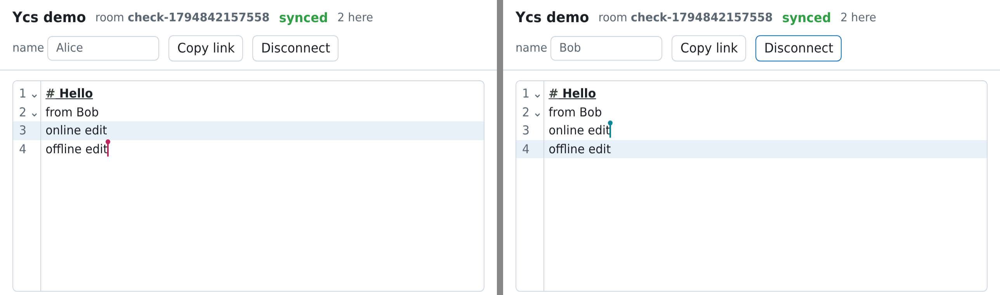

# Networking

Ycs speaks the Yjs network protocol, [y-protocols](https://github.com/yjs/y-protocols), so a .NET process can sync
with the standard Yjs providers. This page shows the protocol in C#, then the samples built on it: a sync server, a
.NET client, a Blazor WebAssembly page and a demo editor.

| Part | Where | What it is |
| --- | --- | --- |
| `SyncProtocol` | the library | the y-protocols sync messages: step 1, step 2, update |
| Sync server | `samples/Ycs.Server` | an ASP.NET app: one document per room, over WebSocket (y-websocket's wire) and SignalR |
| .NET client | `samples/Ycs.Client` | a y-websocket provider over `ClientWebSocket`, with awareness |
| Blazor page | `samples/Ycs.Blazor` | a textarea edited together with Yjs clients, Ycs running in the browser |
| Demo page | `samples/Ycs.Server/wwwroot` | a CodeMirror 6 editor on Yjs, served by the sync server |

The samples are samples: copy what you need. Only `SyncProtocol` is part of the library.

## The sync protocol

Two peers each send *step 1* (their state vector). Each answers the other's step 1 with *step 2* (the update the
other lacks). After that, every local change goes out as an *update* message. y-websocket puts a message type in
front of each message: `0` for sync, `1` for awareness (who is online, where their cursor is).

```csharp
using System.Buffers;
using Ycs;

// y-websocket frames: the first byte is the message type (0 = sync), then the sync message.
const byte MessageSync = 0;

static byte[] Step1(YDoc doc)
{
    var message = new ArrayBufferWriter<byte>();
    message.Write([MessageSync]);
    SyncProtocol.WriteSyncStep1(message, doc);
    return message.WrittenSpan.ToArray();
}

static byte[] UpdateMessage(byte[] update)
{
    var message = new ArrayBufferWriter<byte>();
    message.Write([MessageSync]);
    SyncProtocol.WriteUpdate(message, update);
    return message.WrittenSpan.ToArray();
}

// Handles one received frame; returns the answer to send back, or null.
static byte[] Receive(YDoc doc, byte[] frame, object origin)
{
    if (frame.Length == 0 || frame[0] != MessageSync)
    {
        return null; // awareness and other message types are not handled here
    }

    var reply = new ArrayBufferWriter<byte>();
    reply.Write([MessageSync]);
    SyncProtocol.ReadSyncMessage(frame.AsSpan(1), reply, doc, origin);
    return reply.WrittenCount > 1 ? reply.WrittenSpan.ToArray() : null;
}

var server = new YDoc();
var client = new YDoc();
server.GetText("content").Insert(0, "from the server. ");
client.GetText("content").Insert(0, "from the client. ");

// Each side sends step 1; the other answers with step 2.
Receive(client, Receive(server, Step1(client), "client"), "server");
Receive(server, Receive(client, Step1(server), "server"), "client");

// From then on, each local update goes out as an update message.
client.Updated += (_, e) => { if (e.Origin as string != "server") Receive(server, UpdateMessage(e.Update.ToArray()), "client"); };
client.GetText("content").Insert(0, "Live: ");

Console.WriteLine(server.GetText("content").ToString() == client.GetText("content").ToString()); // True
```

- The writers (`WriteSyncStep1`, `WriteSyncStep2`, `WriteUpdate`) append to any `IBufferWriter<byte>`; the readers take
  a whole message as a `ReadOnlySpan<byte>` or a `ReadOnlySequence<byte>` and write the answer to a step 1 to `reply`.
  Bytes after the message are ignored; `ReadSyncMessage` returns its `SyncMessageType`. Nothing is allocated per
  message beyond pooled buffers and the update's own decoding.
- `SyncProtocol` uses the v1 update format, as y-protocols does. Pass `v2: true` on both ends for v2.
- A malformed message throws `YUpdateException`, an unknown message type and a truncated one included. y-protocols'
  `readSyncStep2` passes the error of the apply to a handler and carries on; here the exception propagates and the
  document is as it was, so drop the message (and, from an untrusted peer, the peer), or catch it where you read.
- Awareness is not in the library. The sync server has a port of y-protocols' awareness
  (`samples/Ycs.Server/Awareness`), byte-compatible with it, that you can copy.

## The sync server

```bash
dotnet run --project samples/Ycs.Server
```

It listens on `http://localhost:5000` (set `--urls` to change it) and serves:

| Path | Transport | Clients |
| --- | --- | --- |
| `/ws/{room}` | WebSocket, one binary message per y-protocols message | y-websocket's `WebsocketProvider` with the URL `ws://host/ws`; the .NET client |
| `/hub?room={room}` | SignalR (JSON protocol), the same messages | `interop/signalr/provider.mjs` |
| `/` | static files from `wwwroot`, or the folder given with `--webroot` | the demo page, or a published Blazor client |

Each room holds one Ycs document and its awareness states. Clients of both transports can share a room. On connect,
the server sends step 1 and the room's awareness; it relays each update and awareness change to the room's other
clients. A malformed message closes only the connection that sent it; the document stays as it was.

Settings, in the configuration section `WebSocket` (for example `--WebSocket:MaxMessageBytes 1048576`):

| Setting | Default | What it does |
| --- | --- | --- |
| `MaxMessageBytes` | 16 MiB | the largest message a client may send (WebSocket and SignalR); a larger one closes the connection |
| `KeepAliveInterval` | 30 s | how often the server pings an idle client |
| `KeepAliveTimeout` | 30 s | how long it waits for the answer before dropping the connection |
| `CloseTimeout` | 5 s | how long a closing connection may take |

Awareness states expire after 30 s without renewal, as in y-protocols.

**What it does not do.** It keeps documents in memory only, as long as the process runs: nothing is saved, and a
room is never removed. It has no authentication. It runs on one machine. It is a sample and a test bed, not a
hardened server; add persistence, access control and eviction before you put it on the internet.

### Browser clients in JavaScript

An unmodified y-websocket client connects to it:

```js
import * as Y from 'yjs'
import { WebsocketProvider } from 'y-websocket'

const doc = new Y.Doc()
const provider = new WebsocketProvider('ws://localhost:5000/ws', 'my-room', doc)
doc.getText('content').insert(0, 'Hello from Yjs')
```

Over SignalR, copy [`interop/signalr/provider.mjs`](https://github.com/msallin/ycs/blob/modernize/interop/signalr/provider.mjs)
(it needs `yjs`, `y-protocols`, `lib0` and `@microsoft/signalr`) and use it as y-websocket's provider:

```js
const provider = new SignalRProvider('http://localhost:5000/hub', 'my-room', doc)
```

Tested with y-websocket 3.1.0, y-protocols 1.0.7 and @microsoft/signalr 11.0.0.

### The demo page

Run the server and open `http://localhost:5000/`: a CodeMirror 6 Markdown editor on a `Y.Text` named `content`, with
the other editors' cursors and names, a status line, a link to the room (the URL fragment) and a button to go offline
and come back. `?transport=signalr` uses SignalR. Open the link in a second browser to edit together.



The page's bundle is committed; [`samples/Ycs.Server/demo`](https://github.com/msallin/ycs/blob/modernize/samples/Ycs.Server/demo/README.md)
rebuilds it.

## The .NET client

`samples/Ycs.Client` is y-websocket's provider in C#, over `ClientWebSocket`: it syncs a document with a room,
reconnects with y-websocket's backoff and merges what was edited offline, and keeps the client's awareness state. It
runs on .NET and in the browser. Its types are `internal`: copy the files into your project (with
`samples/Ycs.Server/Awareness/Awareness.cs` and `AwarenessChange.cs`, which it shares with the server).

```csharp
using Ycs;
using Ycs.Client;

var doc = new YDoc();
await using var provider = new WebsocketProvider(new Uri("ws://localhost:5000/ws"), "my-room", doc);
provider.Connect();

// Every read and edit of the document holds the provider's gate: the provider applies
// the server's updates on its own thread.
lock (provider.Gate)
{
    doc.GetText("content").Insert(0, "Hello from .NET");
}
```

| Member | What it gives |
| --- | --- |
| `Status`, `Synced`, `StatusChanged` | connecting, connected or disconnected; whether the first sync is done |
| `Received` | raised after an update from the server was applied |
| `SetLocalState(json)`, `RemoteStates`, `AwarenessChanged` | this client's awareness state, and the others' |
| `DisposeAsync()` | leaves the room: clears the awareness state, sends what is queued, closes |

`SharedText` in the same folder binds a `Y.Text` to a plain textarea (one transaction per edit, remote changes as
text ranges, caret positions carried through them).

## The Blazor client

`samples/Ycs.Blazor` is a Blazor WebAssembly page built on the .NET client: a textarea that Ycs, running in the
browser, edits together with Yjs clients in the same room. Publish it and let the sync server serve it:

```bash
dotnet publish samples/Ycs.Blazor -c Release -o out/blazor
dotnet run --project samples/Ycs.Server -- --webroot out/blazor/wwwroot
```

Open `http://localhost:5000/#my-room`. The fragment is the room (a random one when it is empty); `?server=ws://…/ws`
points the page at another server. To edit next to the demo page, start a second instance for the Blazor files only
(`--urls http://localhost:5001 --webroot out/blazor/wwwroot`) and open
`http://localhost:5001/?server=ws://localhost:5000/ws#my-room` and `http://localhost:5000/#my-room`.

## Checks

`interop/server/smoke.sh` runs two y-websocket clients from Node against the server;
`interop/server/converge.sh` runs seeded random clients (edits, drops, offline edits, rejoins) over WebSocket,
SignalR and both mixed, and checks that every client, a fresh client and plain Yjs agree, on the Ycs server and on the
reference server `@y/websocket-server`. See
[`interop/server/README.md`](https://github.com/msallin/ycs/blob/modernize/interop/server/README.md).
